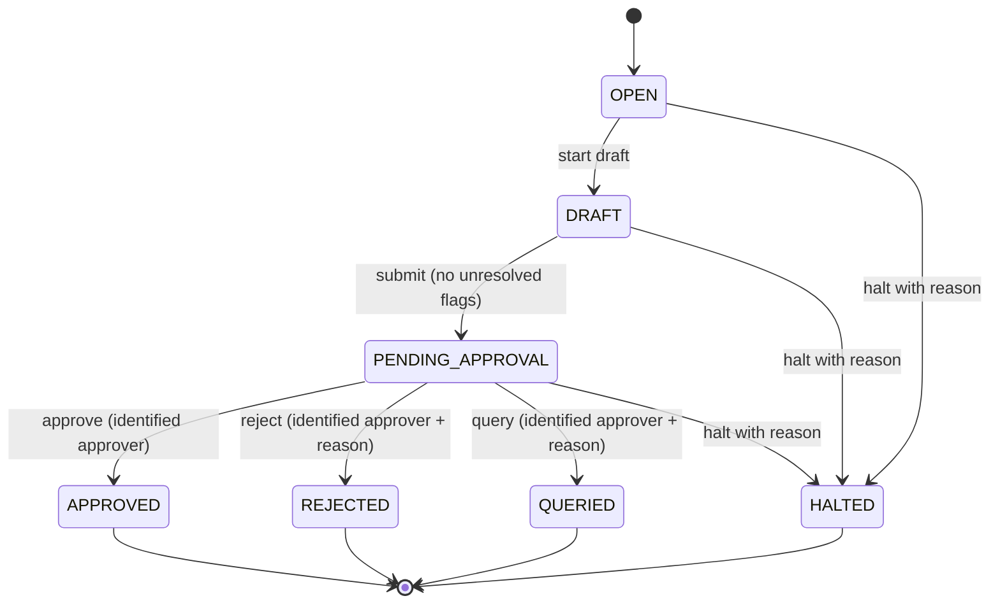

# Procurement workflow state model

## States and transitions

| Current state | Action | Next state | Conditions |
|---|---|---|---|
| — | Create case | `OPEN` | Unique case identifier |
| `OPEN` | Start draft | `DRAFT` | Case exists |
| `DRAFT` | Submit | `PENDING_APPROVAL` | No unresolved policy flags |
| `PENDING_APPROVAL` | Approve | `APPROVED` | Non-empty approver identity |
| `PENDING_APPROVAL` | Reject | `REJECTED` | Non-empty approver identity and reason |
| `PENDING_APPROVAL` | Query | `QUERIED` | Non-empty approver identity and reason |
| `OPEN`, `DRAFT`, `PENDING_APPROVAL` | Halt | `HALTED` | Non-empty halt reason |
| `APPROVED`, `REJECTED`, `QUERIED`, `HALTED` | Any transition | — | Not permitted |

`QUERIED` and `HALTED` are recorded terminal outcomes for this case model; a
response to a query starts a new case. No path allows a draft or open case to
be approved directly.

## Persistence and restart

`src.workflow.case_store.CaseStore` stores workflow cases in SQLite at
`data/application_state.sqlite3` by default. Callers may provide another
database path, which is useful for tests and separate deployments.

Each case row stores its state, item, source quotations, computed comparison,
flags, timestamps and decision details. JSON fields are serialized losslessly
for JSON-compatible values. A separate `workflow_case_events` table records
creation and each successful transition. State changes and their event rows
are committed in one transaction. `get_case` reconstructs the recorded values,
and `list_resumable_cases` returns cases in `OPEN`, `DRAFT` or
`PENDING_APPROVAL`.

The existing CSV requisition store remains for compatibility with the current
agent draft flow; the SQLite case store is the durable resume model.

## Confirmed supplier preference memory

`src.memory.record_supplier_preference` requires `confirmed=True` and a
non-empty confirmer identity before writing a supplier preference. The write
records the confirming person and a UTC timestamp. Calling it without explicit
confirmation raises `PreferenceConfirmationRequiredError` and writes nothing.

On quotation comparison, the tool router attaches the most recent preference
for that item as `supplier_preference_hint` for the officer-facing agent
context. The deterministic comparison function does not read memory, and the
hint is never used to alter eligibility, costs or ranking.
